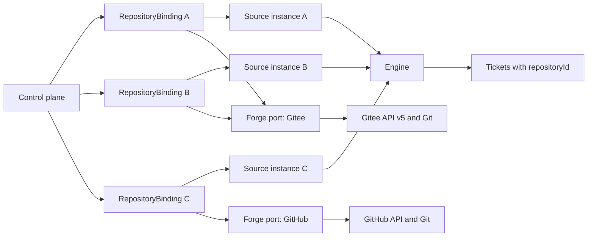

# 009 Multi-repository and multi-forge roadmap

This document defines the long-term repository identity model and the delivery path from the upstream prototype's single GitHub repository to multiple repositories across multiple forges. Gitee is the first additional forge and GitLab the second; the protected token-credential boundary is shared by both.

This is a clean-break design. The current prototype stores one global GitHub repository, so the new model starts with a fresh state directory. It does not migrate old settings, domain records, cursors, or credentials, and it keeps no fallback path for the old global configuration.

## Decision

Use one control plane with many explicit `RepositoryBinding` aggregates.

- A repository is a first-class domain identity. Its stable key is the forge's immutable repository ID, not a mutable `owner/name` slug.
- A Source kind is an implementation. A Source instance is a configured stream and has its own stable ID. Multiple instances of one kind may run at the same time.
- Every repository-bound Source instance belongs to exactly one binding. Threads, Triggers, Tickets, work directories, credentials, polling cursors, health, concurrency, and pull-request lifecycle are resolved through that binding.
- A forge adapter is registered once per provider and serves every binding for that provider. Do not start one process per repository and do not put provider conditionals into the Engine.
- Provider differences stay behind capability-specific ports. Do not force Gitee and GitHub into one lowest-common-denominator API that hides native IDs, review behavior, CI, or links.

## Why configuration alone is insufficient

The current code does not merely lack a list of repositories. Repository identity is global in every major layer:

| Area | Current assumption | Consequence |
| --- | --- | --- |
| Deployment | `Deployment` contains one `repository` and one GitHub account (`src/deployment.ts:53-57`). Setup resolves exactly that repository and writes one worker environment (`src/app/setup.ts:76-97`). | A second repository would overwrite or share the first repository's account and command environment. |
| Commands | `Commands.repository` is global, and `Commands.api` prefixes every call with `repos/<that repository>` (`src/infra/commands.ts:59-98`). | A request cannot select a repository, and every API call has an implicit GitHub dependency. |
| Worker environment | The worker shim and git config contain one GitHub credential entry and one set of GitHub URL rewrites (`src/infra/environment.ts:79-115`). | Workers cannot safely operate on repositories from different providers or accounts. |
| Source registry | Settings and registry lookup use the Source kind as the instance ID (`src/policy.ts:98-105`, `src/sources/registry.ts:44-57`, `133-137`). Health is claimed per kind (`src/sources/github.ts:63`, `112-121`). | Two GitHub repositories collide in configuration, policy, health, cursors, and registry lookup. |
| Source context | `SourceContext` exposes one deployment and one command wrapper (`src/sources/host.ts:31-66`). | A Source cannot identify which repository binding is receiving or writing. |
| Domain references | `ActorRef`, `ThreadRef`, and `ChannelRef` carry only a Source string; `threadKey` is `<source>:<id>` (`src/core/model.ts:4-12`). | GitHub thread `12` in two repositories has one key. |
| Tickets | A Ticket has no repository binding (`src/core/model.ts:276-308`), and creation takes no repository argument (`src/core/evals.ts:305-315`). | The Executor cannot know which remote, credential, policy, or workspace owns the work. |
| Pull lifecycle | PR binding uses a thread named `github:<number>`, compares against the global account and repository, and scans all open tickets (`src/sources/github-pull.ts:18-49`). | PR numbers and branch names cross repository boundaries. |
| Executor tools | Every worker tool host injects one GitHub Source context (`src/app/tools/executor.ts:13-20`, `82-92`). | A Gitee or second-GitHub Ticket still tries to use the global GitHub client. |
| Workspace and concurrency | Ticket directories come from one execution root (`src/executor/dsh.ts:97-110`) and worker slots use one global `maxWorkers` (`src/executor/dsh.ts:228-232`). | Repositories share directory structures and capacity policy. |
| Policy | Policy parts are keyed by Source kind and hashed globally (`src/policy.ts:99-117`, `src/sources/registry.ts:59-74`). | One repository's participants and admission rules cannot be isolated from another's. |
| Persistence | The schema has global trigger, thread, ticket, and decision tables and migrates older schemas at startup (`src/app/store.ts:54-90`). | There is no durable repository foreign key to enforce isolation. |

Adding a Gitee branch beside each of these globals would spread provider conditionals through setup, polling, commands, prompts, tools, health, and the UI. That is not an acceptable intermediate design.

## Target model



### RepositoryBinding

`RepositoryBinding` is the configuration and ownership boundary for one remote repository.

Required fields:

- `id`: stable key in the form `<provider>:<providerRepositoryId>`, for example `gitee:151`.
- `provider`: registered forge adapter ID, such as `gitee` or `github`.
- `providerRepositoryId`: immutable ID returned by the forge.
- `slug`: mutable human-readable `owner/name`, used for display and repository resolution, never as identity.
- `webUrl`: canonical provider page.
- `credentialId`: reference to a protected credential source. The secret itself is not part of domain state.
- `enabled`: operational switch.

Repository-scoped operational fields, when introduced, belong to the binding rather than a global deployment object: execution root, worker limit, default branch, polling scope, and policy inputs. A binding is created only after the provider adapter resolves the repository and verifies read/write access.

The binding is also the unit of onboarding and inspection. The panel shows one row per binding with slug, provider, account, health, active workers, queued work, and last successful poll. Enabling or disabling one binding does not restart the others.

### Source identity

Separate two concepts that the prototype currently conflates:

- `SourceKind`: registered code, configuration schema, and provider capabilities. Examples: `github`, `gitee`, `feishu`.
- `SourceInstance`: one enabled configuration with a stable `sourceId`; a repository-bound instance includes exactly one `repositoryId`.

All domain references use the Source instance ID, not the kind. A thread key becomes `<sourceId>:<providerThreadId>`. This makes `gitee:151:IKS135` and `gitee:152:IKS135` distinct even though both providers use the same native issue number.

The Source registry stores instances by `sourceId`, runs one poll loop per enabled instance, and keeps health and cursors under that instance. Registering a new kind does not implicitly create a repository or start polling.

For the first multi-repository release, a forge Source instance has a one-to-one relationship with a `RepositoryBinding`. Other Source types may remain non-repository sources, but a Ticket created from them must still receive an explicit repository binding at accept time. Cross-repository intent must be represented in the Trigger or assessment input; it must never fall back to an arbitrary "current" repository.

### Domain and persistence

The following identities become explicit and immutable:

- `Trigger`: `sourceId`, `repositoryId | null`, provider-native event ID, and provider-native thread IDs.
- `Thread`: keyed by `sourceId` plus native thread ID, with `repositoryId | null`.
- `Evaluation` and `Decision`: carry the same repository context as their Thread.
- `Ticket`: carries `repositoryId` from acceptance through every Assignment and report, including tickets resumed after closure.
- `Follow`: identifies a provider PR by binding plus stable provider ID; the display number and URL are metadata.
- `Assignment`: resolves its workspace and provider capabilities through the Ticket's binding.

SQLite tables include `repository_id` as a non-null indexed foreign-key-like column for repository-bound domain records. The Engine remains the only writer of domain state, and every transaction can assert that a Trigger, Thread, Ticket, and Follow agree on the repository.

Because this fork has no production data contract yet, the first implementation bumps to a new schema with no old-schema migration. Running it against an old state directory must fail with an explicit instruction to use a new state directory. Do not copy old records, reinterpret the old global GitHub repository, or keep dual read paths.

### Forge adapter boundary

Register one adapter per provider. Keep ports narrow enough to preserve native behavior:

- `RepositoryAccess`: resolve by slug or native ID, return canonical ID/slug/URLs/default branch, and verify push access.
- `EventReader`: poll repository events, issues, pull requests, comments, and supported CI state with per-instance cursors.
- `IssuePort`: read issue, list comments, create comment, and update state where the provider supports it.
- `PullRequestPort`: create, read, list, bind, observe state, and merge or close; return stable provider IDs, display numbers, head/base refs, author, and timestamps.
- `CredentialPort`: resolve a credential reference and prepare Git authentication for a binding without exposing the secret to prompts, logs, or ordinary worker environment variables.
- `Presentation`: produce provider links, display facts, and capability descriptions. The provider may have no CI support without pretending it behaves like GitHub Actions.

Adapters may share small transport utilities, but they do not share a provider-shaped API. The Engine and Executor depend on capability ports, not on `gh`, Gitee response fields, or a global API prefix.

The existing dependencies are sufficient for the first Gitee adapter: Node 22's `fetch`, `AbortSignal`, `URL`, and the existing `zod` schemas. No Gitee SDK or general-purpose HTTP framework is required. Every response is validated at the adapter boundary, and HTTP errors are normalized without logging tokens or response bodies that may contain secrets.

### Workspace, credentials, and concurrency

Every Ticket workspace lives under a binding-specific namespace, for example:

```text
<stateDir>/work/<repositoryId>/<ticket-name>
```

The clone remote and local Git configuration are established from that binding. A worker receives only the credential helper or protected file handle it needs for its Ticket. Credentials for different bindings must not be merged into one global git config.

The scheduler queues by Ticket and reserves capacity within the Ticket's binding. A per-binding limit prevents one repository from consuming every worker slot. A global cap may remain as a host resource guard, but it is not the repository policy itself. Health reports pending and running work per binding.

Policy is also binding-scoped. An accepted Mandate records `repositoryId`, the binding's policy inputs, and the policy version. Source participant lists, admission behavior, and repository-specific rules are keyed by Source instance or binding, not Source kind. A policy change can invalidate only the Evals and Tickets whose binding inputs changed.

### Routing and worker tools

Repository routing is decided before Eval:

- A Gitee or GitHub Issue/PR Trigger inherits the repository of its Source instance.
- A non-repository Trigger must carry an explicit binding chosen by its configured route or assessment context.
- An Assessment cannot silently change the binding of an existing Ticket.
- A resumed Ticket reuses its stored binding and policy context.

Worker tools resolve the current Ticket's binding and then ask the provider adapter for `readPull`, `claimPull`, comment, PR, and link operations. There is no `host.github` singleton. Tool error messages name the provider and repository so a cross-repository PR claim is visibly rejected.

## Gitee-first provider mapping

The Gitee REST API v5 is available under `https://gitee.com/api/v5`. Live unauthenticated reads on 2026-11-01 confirmed the following shapes:

- Repository lookup (`/repos/oschina/git-osc`) returns a numeric immutable `id` (`151`), mutable `full_name`, HTML/SSH clone URLs, default branch metadata, and namespaces.
- Issue lists (`/repos/oschina/git-osc/issues`) return a string native `number` such as `IKS135` and a numeric immutable `id`. Issue URLs use the string number.
- Pull lists (`/repos/oschina/git-osc/pulls`) return a numeric `number` and a separate immutable `id`, plus state, author, head/base refs, timestamps, and merge/closure state.

The adapter therefore stores both native identity and display identity where Gitee distinguishes them:

- Repository identity: numeric `id`.
- Issue identity: numeric `id`; display key: string `number`.
- Pull request identity: numeric `id`; display key: numeric `number`.
- Comment identity: native comment `id`, never a positional index.

Authenticated Gitee access uses a personal access token supplied by the operator through the credential reference. The implementation validates the authenticated user and push access before enabling the binding. Token handling must remain out of persisted domain rows, prompts, command arguments, error text, and normal worker environment variables. Git operations use HTTPS with the binding's credential helper; SSH keys may be added later as a distinct credential type, not as an implicit fallback.

Gitee polling is the first event source. Webhooks are not required for the first end-to-end slice because they introduce public ingress, signature handling, replay storage, and deployment-specific configuration. Add webhook delivery only after polling semantics and durable cursors are proven.

### Phase 3 implementation notes

The Phase 3 adapter confirms these API v5 details against the prepared canary and public repositories:

- Authenticated reads send `Authorization: token <token>`; the token is read from the environment variable the Source's credential reference names and never appears in a URL, log, database row, prompt, or worker environment.
- Repository access is reported in `permission` as `{pull, push, admin}`; `html_url` ends in `.git` and is normalized to the web page.
- Issue detail and comment endpoints take the string display `number` (`IKS47K`), not the numeric `id`; the numeric `id` is the Thread identity. The Issue list supports `since` by update time and `page`/`per_page` with `total_page`/`total_count` headers. The comment list applies `since` strictly after the timestamp, so the adapter pages it and applies the cursor's inclusive comparison itself; otherwise a comment updated at exactly the cursor time would be dropped.
- Pull-request detail also takes the display `number`; reads by numeric `id` return 404. The record keeps `id` as the immutable identity and `number` as display metadata.
- A comment changes its Issue's `updated_at`, so the Issue stream sees new comments even on older Issues; the source then reads that Issue's comments from its own cursor.
- The account's own Issues and comments are stored as non-human Trigger facts (`human: false`, `meta.self`) so a prepared canary remains observable, but the gate refuses them before an Eval: self-authored events can never authorize work.
- Capability facts on the binding report Issues/comments/PR reads as supported and Gitee PR creation, PR comments, reviews, CI, and ticket execution as unsupported until Phase 4 implemented them. The core consults the binding's `execution` capability before accepting work: a Gitee Trigger was assessed and then recorded as an `executionUnsupported` ignore, so no Ticket or runnable Assignment was created.

### Phase 4 implementation notes

The contract-backed Gitee write path is implemented through the existing Engine, Ticket, workspace, and RepositoryBinding contracts; no Gitee-shaped executor exists:

- `src/forge/ports.ts` generalizes only the operations this slice needs: Issue and PR comment writes, PR creation and PR comment reads, per-call provider context, the provider Git host, and the provider-native pull-request Thread identity. The Gitee adapter reports Issue/PR comments and PR creation as supported, reviews and CI as unsupported, and `execution: true` now that the complete write path exists.
- `src/forge/pulls.ts` resolves a PR by its immutable native ID or display number and claims it with the binding and native ID. It refuses a PR from another repository, another account unless it is the verified source PR, and one another open Ticket already follows. A Gitee followed PR's Thread is `pull:<native ID>`; its display number is stored on the Thread for the detail endpoint.
- Worker operations are provider-neutral: `orchestrator_pull_request` creates, reads, or claims through the ticket binding's adapter, and `orchestrator_comment` writes an idempotent comment on the originating Issue with a hidden marker keyed by the ticket and a stable status key.
- The Gitee Source kind provides a Channel: acknowledgements, answers, and results go to the originating Issue or pull request as comments marked by the Outbox message ID, so a retry or restarted process posts once. `orchestrator_comment` remains the worker's explicit status/result comment with a stable ticket-scoped key.
- Gitee Git authentication uses a generated helper that carries no secret and asks a host broker over a private Unix socket. The broker answers only for an enabled Gitee binding and its exact repository, reading the token from the host process on each request; the token stays out of arguments, prompts, logs, SQLite, generated credential files, and ordinary worker environment variables. Git is configured for `https://gitee.com` with the binding-scoped helper and URL rewrites, and the prepared worker environment names the binding, account, and commit email without a token.
- The Gitee Source observes the claimed PR's state and both its conversation and diff comments through Gitee's pull-request comment endpoint, from persisted cursors. A merged or closed PR ends the correct Ticket; Gitee's `closed` state with `merged_at` counts as merged. The Ticket's `follows` and Thread metadata survive a restart, and deterministic Trigger IDs prevent duplicate comments or closures.
- `tests/gitee-execution.spec.ts` covers Issue -> Ticket -> PR create/claim -> result comment -> restart -> PR comment -> merged outcome, the two-fresh-state repeat, cross-binding and cross-ticket refusal, and secret scans of the helper, environment, requests, and SQLite.

The live gate is satisfied. Two independent runs started from fresh state directories and used Issues authored by the distinct human account `kikokokiqp-agent` on `bourneW/dsh-superagent-gitee-canary`:

- The first run turned human Issue `IKS610` into a repository-bound Trigger, Ticket, worker branch, and Gitee pull request #4. A process restart preserved the state without duplicating the Trigger or Ticket, and the human account merged the pull request with SHA `46409053cdbf9443a95845afd0d4460e85ea957c`.
- The second run used human Issue `IKS6CP` and produced a separate Trigger, Ticket, worker branch, and Gitee pull request #5. A restart preserved exactly one Trigger, decision, Ticket, two Threads, and two Outbox rows. The human account merged the pull request with SHA `a2da30b5b8bb64ec32accf61851a1e84ac9c3b48`; polling observed the merge and ended the owning Ticket.

Both runs preserved the non-human classification and refusal of `bourneW`'s self-authored events. A scan of three state directories, three profiles, and the source worktree found no token value outside the expected host-process environment. The full acceptance evidence is recorded on GitHub pull request #16.

## Delivery roadmap

Each phase must leave the product runnable. A phase is not accepted merely because types compile; its stated end-to-end behavior must be demonstrated.

### Phase 0: Baseline and decisions

Deliver:

- GitHub fork and upstream remote.
- This roadmap and source audit.
- A clean-break schema decision and explicit non-goals.

Gate:

- `pnpm check` passes.
- The roadmap traces every singleton assumption to current code.

### Phase 1: Repository identity and instance isolation

Deliver:

- `RepositoryBinding` and Source instance IDs.
- Repository-aware Trigger, Thread, Ticket, channel, health, cursor, and settings types.
- Source registry support for multiple instances of one kind.
- A fresh schema with repository columns and no old-schema migration.
- Binding-aware repository access and credential/environment construction.
- Provider-neutral Ticket tool lookup with the existing GitHub adapter behind it.

Gate:

- Unit and integration tests prove that identical native thread IDs in two fake repositories remain distinct.
- Existing single-Repository GitHub work remains end-to-end functional under the new fresh-state schema.
- There is no path that reads a global repository after a Ticket has been accepted.

This phase is a durable migration of the architecture, not a compatibility adapter.

### Phase 2: Multiple GitHub repositories

Deliver:

- Multiple enabled GitHub Source instances in one process.
- One poll loop, health entry, cursor set, workspace namespace, and scheduler group per binding.
- Repository-qualified PR binding and cross-repository claim rejection.
- Binding-aware policy and Mandate versioning.
- Panel support for adding, enabling, inspecting, and disabling repository bindings.

Gate:

- Two GitHub test repositories each accept an Issue, run one worker, and report a PR without sharing cursors, credentials, workers, or workspace directories.
- Thread/PR number collisions and branch-name collisions cannot bind across repositories.
- Disabling one repository leaves the other's polling and active Tickets running.

### Phase 3: Forge port and Gitee read path

Deliver:

- Capability ports for repository access, events, issues, pull requests, credentials, and presentation.
- A Gitee API v5 adapter using `fetch`, `AbortSignal`, and `zod`.
- Gitee repository resolution, authenticated identity/access check, polling cursors, issue/comments, and pull-request reads.
- Capability facts in the panel, including unsupported CI or review features.

Gate:

- Adapter contract tests run against recorded Gitee fixtures plus a live read-only smoke test.
- A Gitee binding can ingest an Issue and its comments into repository-scoped Triggers and Threads.
- A restart resumes from persisted cursors without duplicating Triggers.
- Gitee issue display numbers and pull request numbers are stored using their distinct native identities.

### Phase 4: Gitee end-to-end work

Deliver:

- Gitee credential helper and binding-scoped Git configuration.
- Gitee workspace preparation and clone/push support.
- Ticket tools for Gitee pull request create/read/claim and comments.
- PR state observation for merged and closed outcomes.
- Gitee links and terminal notices.

First end-to-end slice:

1. Operator creates one Gitee `RepositoryBinding` and verifies account access.
2. A permitted user creates an Issue and mentions the agent.
3. The Gitee poller stores one Trigger under the binding and its Source instance.
4. Eval accepts the work and creates a Ticket carrying `gitee:<repositoryId>`.
5. The Executor clones into the binding's workspace using the binding credential.
6. The worker commits, pushes a ticket branch, opens a Gitee PR, and reports it.
7. The adapter reads and binds that PR, then observes comment, merge, or close events.
8. The user receives the result in the original Gitee Issue.

Gate:

- The slice runs twice from a fresh state directory with the same result.
- No token appears in process arguments, logs, SQLite rows, prompts, generated files, or worker environment output.
- A PR from another Gitee repository or another account is rejected even when its branch suffix matches the Ticket name.
- Restarting during polling, execution, and PR observation preserves correct Ticket and cursor state.

### Phase 5: Prove the second additional forge

Add a second provider adapter without changing Engine, Ticket, workspace, scheduler, or tool-routing contracts. The acceptance test is two different providers running concurrently in one control plane and proving that provider-specific IDs, credentials, links, and PR behavior remain isolated.

Do not introduce a plugin marketplace or dynamic third-party adapter loader before this second implementation identifies the repeated boundary. Registry registration of built-in adapters is sufficient until then.

### Phase 5 implementation notes

GitLab is the second built-in additional forge, registered beside Gitee without changing the Engine, Ticket, workspace, scheduler, or tool-routing contracts:

- `src/forge/gitlab.ts` uses the official GitLab REST API v4 at `https://gitlab.com/api/v4` with `PRIVATE-TOKEN`. Repository resolution reads `/projects/:id` with the URL-encoded project path (nested group paths included), verifies the authenticated user's `permissions.project_access.access_level` or `permissions.group_access.access_level` is at least Developer (30), and persists the numeric project ID as `providerRepositoryId`. Normal operations use that numeric ID.
- Issues use `/projects/:id/issues` and `/projects/:id/issues/:issue_iid`; their global numeric `id` is the native Thread identity and their project-scoped `iid` is the display number. Merge requests use `/projects/:id/merge_requests` and `/projects/:id/merge_requests/:merge_request_iid`; the global MR `id` is stored as the followed Thread's native identity (`pull:<id>`) and the `iid` is display metadata. Notes use the Issue and merge-request notes endpoints. List reads page by `X-Next-Page` and filter by the documented `updated_after`; notes carry no timestamp filter, so the adapter pages them and applies the persisted cursor itself.
- The adapter drops every `system: true` note, so system activity never becomes a Trigger. Trigger IDs derive from the Source instance, repository binding, and native IDs; persisted cursors and native-ID deduplication therefore survive restarts. The Source records the account's own events as non-human facts and refuses them at the gate, as the Gitee Source does.
- Claimed merge requests are observed per binding: merge, close, or locked ends only the Ticket that follows that merge request; a missing or failed read stays on its Thread and fails only that Source's poll.
- The built-in Source kind, its Channel, health owner, panel fields, bundle registration, and the `dsh-superagent-gitlab` worker skill are registry entries, not a plugin loader.
- `src/forge/token-credential.ts` replaces the Gitee-specific credential record and broker with one provider-neutral protected token boundary for Gitee and GitLab. A helper names its binding, provider, host, and repository; the broker answers only for an enabled binding with exactly that tuple and reads the token from the host process at request time. Gitee's HTTPS behavior is unchanged; GitLab uses its documented HTTPS personal-access-token authentication. Git configuration and helper paths contain no secret, and no token enters arguments, URLs, generated files, the database, prompts, logs, worker environment, or worker output.
- `tests/gitlab-forge.spec.ts`, `tests/gitlab-source.spec.ts`, `tests/token-credential.spec.ts`, and the opt-in `tests/gitlab-live.spec.ts` cover the documented routes and headers, paging and cursors, system-note exclusion, native IDs versus IIDs, access checks, merge-request lifecycle, concurrent Gitee + GitLab collision isolation, a single-provider poll failure, and credential isolation. The live smoke needs `GITLAB_LIVE_TOKEN_FILE` and `GITLAB_LIVE_PROJECT` and is skipped without them.

PR #20 passed independent code review and `pnpm check` and was merged at `048d4970fbb32a27ea53a64719baefc4aeef9fd8`. The disposable live GitLab project flow was not executed because the user explicitly deferred GitLab live acceptance for the current scope. This scope waiver closes the Phase 5 delivery, but it is not evidence that real GitLab authentication, Git push, merge-request creation, or polling works. Run the gated live smoke before operating a real GitLab binding.

## Test strategy

Use three layers:

1. Domain tests: repository identity on Trigger/Thread/Ticket, collision resistance, Mandate policy versioning, and resumed Tickets.
2. Adapter contract tests: the same repository, issue, comment, PR, merge, close, and access-check scenarios against a fake provider and provider-specific fixtures.
3. End-to-end tests: a fake forge for fast CI, then one opt-in disposable Gitee repository for real authentication, Git push, PR creation, and event polling.

The fake forge should model two repositories with the same issue number, PR number, branch name, and actor login. That collision matrix is the primary regression test for every phase.

## Operational safety

- Credentials are resolved only by the provider adapter or its Git helper. Domain records store `credentialId`, never the secret.
- API and Git error messages are sanitized before persistence or display.
- Each binding has independent health and cursor state. One forge outage must not stop other repositories.
- A repository slug change updates display and resolution cache but not `repositoryId` or any domain foreign key.
- A deleted or unreadable repository pauses only its binding and preserves queued work for diagnosis; it does not reassign work elsewhere.
- The control plane remains one OS process. Isolation comes from binding IDs, credentials, workspaces, cursors, policy, and scheduler groups, not from process sprawl.

## Explicit non-goals for the first implementation

- No migration or compatibility layer for the current global GitHub state.
- No arbitrary "default repository" fallback.
- No Gitee webhook requirement.
- No universal forge feature grid that hides unsupported capabilities.
- No process-per-repository deployment.
- No dynamic third-party plugin marketplace.
- No cross-forge mirroring or simultaneous duplicate execution of one Ticket.

## Mature-product pattern and references

The repository-first installation model follows established multi-repository automation products. Renovate, for example, treats each onboarded repository independently and supports fixed repository lists or account-granted repository discovery (`https://docs.renovatebot.com/getting-started/installing-onboarding/`). This validates explicit repository onboarding, per-repository state, and account-scoped credential grants.

Provider validation uses the public Gitee API v5 endpoints under `https://gitee.com/api/v5`. The examples in this document were read live on 2026-11-01; implementation must validate authenticated behavior and each capability against the current API before release.
