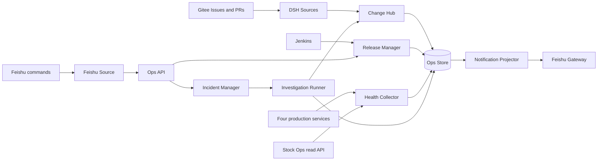

# 010 飞书运维一体化架构

状态：已提出，尚未实现。本文定义 DSH Superagent 面向四个 HeroQuant 仓库的变更、发布、健康、告警、事故调查和飞书交互边界。它是 Phase 6 的架构基线，不代表任何发布链路已经通过实机验收。

## 目标与结论

把 Gitee Issue/PR、Jenkins 构建与发布、四个项目的线上健康、关键事件推送和线上问题调查统一到一个飞书入口，同时保留以下事实边界：

1. Jenkins 构建成功不等于制品需要发布。
2. 制品发布成功不等于目标进程已经切换。
3. 进程存活和 HTTP 成功不等于依赖与业务数据就绪。
4. 一条告警不等于一个事故；事故必须聚合、去重、关联证据并持续更新。
5. 模型可以分析和提出修复，但不能在调查阶段直接改代码、重启服务或触发发布。

架构采用一个 DSH 控制面内的 Ops 运维面，而不是再启动一套独立调度系统，也不引入动态插件市场。Ops 面复用现有 RepositoryBinding、Source、Ticket、Effects、Outbox、Executor 和飞书 Channel 能力，新增的只有项目身份、变更事实、发布状态、健康快照、事故和调查投影。

## 非目标

- 不把四个仓库合并成一个仓库或一个发布单元。
- 不把 Gitee Issue 编号、PR 编号或 Jenkins build 编号当作跨仓库唯一标识。
- 不用 Jenkins `SUCCESS` 代替部署、健康或业务验收。
- 不允许自然语言一句话直接触发生产发布、回滚、重启或数据库写入。
- 不在本阶段引入插件市场、任意第三方 Ops 插件加载器、Kubernetes 迁移或多集群抽象。
- 不为旧 SQLite schema 写迁移或兼容读路径；实现时使用新 schema 和显式升级边界。
- 不在 heroquant-backend 和 heroquant-frontend 发布契约未补齐前宣称其自动化发布已覆盖。

## 当前基线

四个项目都属于 HeroQuant，但它们的变更来源、发布路径和健康证据并不相同。Ops 必须按项目建模，不能套用同一个“部署脚本成功即上线”的判断。

| 项目 | Gitee 仓库 | 已确认的变更来源 | 已确认的发布事实 | 主要健康证据 | 当前限制 |
| --- | --- | --- | --- | --- | --- |
| Stock Extractor | `heroquant/stock-extractor` | Gitee Issue/PR Source 已启用 | `scripts/deploy/jenkins-release.sh` 的 check、package、release 三阶段；Jenkins job `stock-extractor-fc-package` | 进程/PID/RSS、HTTP、systemd、XXL 运行、derived run、ACTIVE 版本、数据缺口、持久化 request/run 事实 | 采集完成不等于业务 `READY`；`/api/stock-extractor-ops` 当前只读且要求 `STOCK_EXTRACTOR_OPS_TOKEN` |
| HeroQuant Agent App | `heroquant/heroquant-agent-app` | Gitee Issue/PR Source 已启用 | Jenkins `BRANCH`、`MODE`；Jenkins -> shell -> Function Compute -> app-host SSH/SFTP；`full`、`frontend-only`、`build-only` | `/health/live`、`/health/ready`、`https://agent.heroquant.com/agent/health`；Jenkins 要求 `backtrade_fc_deployed`、`backtrade_fc_verified`、`agent_fc_routing_configured`、`agent_service_verified` | 必须保留多项部署与验证 receipt；Nginx 不由当前 Jenkins 改动 |
| HeroQuant Backend | `heroquant/heroquant-backend` | Gitee Issue/PR Source 已启用 | 当前是 `deploy/release-production.sh` 直接 SSH 发布，成功后打 deploy tag；远端使用 `/root/app/invest-service` | 公网 `https://www.heroquant.com/server/app-info`；远端 `http://127.0.0.1:8082/server/app-info`；失败时脚本回滚 | 尚无 Jenkins 发布链路；Ops 不能从 DSH 直接执行生产 SSH 部署 |
| HeroQuant Frontend | `heroquant/heroquant-frontend` | Gitee Issue/PR Source 已启用 | 仓库内未发现 Jenkinsfile 或发布脚本 | `www.heroquant.com` 页面、静态资源、`/server` 与 `/pic` 代理链路 | 生产目录、Nginx 配置来源和发布 job 仍需实机盘点 |

Issue/PR 的事实来自现有 built-in Gitee Source。四个 Source 当前均以 `pollSeconds=60`、`observeIssues=true` 运行；PR 观察由具体 Ticket 的 PR follow 进入。Ops 文档接入后，需为每个 Source 配置 `opsProjectId`，只做确定性映射，不改变 Source、Ticket、workspace 或 scheduler 的既有契约。

## 总体架构



数据只向一个方向投影：外部事实先进入不可变的 Ops Event 或带版本的快照，再更新 ReleaseRun、HealthSnapshot、Incident 等状态，最后由 Notification Projector 产生可重试的飞书消息。飞书消息永远不是权威状态，丢失或重复发送不能改变发布或事故事实。

### 内置模块

| 模块 | 责任 | 不负责 |
| --- | --- | --- |
| `ChangeHub` | 把四个 Gitee Source 的 Issue/PR 生命周期归一为项目级变更事实，关联 commit、PR、Ticket 和 ReleaseRun | 决定是否发布；替代 PR 的原始状态 |
| `ReleaseManager` | 检查精确 commit、检查 live Jenkins 参数、触发构建、跟踪 queue/build、执行项目验证 receipt、记录发布状态 | 把 Jenkins 结果直接标成业务可用；直接 SSH 到 backend 主机 |
| `HealthCollector` | 按项目采集 L0-L3 健康证据、保存带时间的 snapshot、识别状态跃迁 | 用一条日志或一次 HTTP 请求宣布根因 |
| `IncidentManager` | 按项目和失败域聚合信号、维护事故生命周期、抑制重复告警、关联发布与调查 | 自动执行生产写操作；替代人工确认 |
| `InvestigationRunner` | 为事故生成只读证据包，按 RepositoryBinding 启动受限调查，保存结论与建议 | 自动提交修复 PR；自动重启、回滚或改数据库 |
| `FeishuGateway` | 把已持久化的通知通过现有 `lark-cli` 机器人发送到指定 chat/topic，并处理受控命令 | 解析模糊自然语言为生产动作；成为业务状态库 |
| `OpsApi` | 为管理页、飞书命令和运维脚本提供同源、本机回环 API | 对外暴露公网管理接口 |

模块只通过明确的输入和输出协作。Engine/Ticket 仍然是工作项的权威所有者；Ops Store 是发布、健康和事故的权威所有者。两者用 `projectId`、`repositoryId`、PR native ID、commit SHA 和可选 `ticketId` 关联，不复制 Ticket 生命周期。

## 身份与关联

所有 Ops 记录使用下述稳定身份，展示名称只用于界面：

- `projectId`：`heroquant-stock-extractor`、`heroquant-agent-app`、`heroquant-backend`、`heroquant-frontend`。
- `repositoryId`：现有 Gitee RepositoryBinding，例如 `gitee:45499062`；仓库 slug 可变，不参与唯一键。
- `environment`：首期固定 `production`，但必须进入每个唯一键，避免以后把测试和生产事实串线。
- `nativeId`：Gitee Issue、PR、comment、Jenkins job/build、commit 的提供方原生 ID。
- `correlationId`：一次完整变更链。建议由 `projectId + targetSha + primaryPrNativeId` 生成；没有 PR 的 hotfix 用 `projectId + targetSha + sourceKey`。
- `dedupeKey`：外部事实的幂等键，例如 `gitee:pull:<nativeId>:merged:<sha>`、`jenkins:<job>:build:<number>:<result>`、`health:<project>:<scope>:<observedAt>`、`incident:<project>:<failureDomain>`。

同一天的 Issue #12、PR #12、build #12 属于三个不同对象。不同仓库的 Issue/PR 即使显示编号相同，也必须由 `projectId + repositoryId + nativeId` 分开。任何状态查询都必须先选择项目，不存在“默认仓库”回退。

### 核心记录

| 记录 | 关键字段 | 说明 |
| --- | --- | --- |
| `OpsProject` | `id`, `repositoryId`, `releaseProfile`, `healthProfile` | 四个项目各一条；profile 选择代码内已验证的驱动，不做用户自定义插件 |
| `ChangeEvent` | `projectId`, `kind`, `nativeId`, `revision`, `actor`, `occurredAt`, `payloadHash` | Issue 创建/关联、PR 打开/更新/合并/关闭、评审和 CI 状态；追加写，可重放 |
| `ReleaseRun` | `id`, `projectId`, `environment`, `targetSha`, `mode`, `state`, `jenkinsBuild`, `evidence`, `requestedBy` | 一次精确 revision 的发布尝试；不按 branch 模糊追踪 |
| `HealthSnapshot` | `projectId`, `level`, `status`, `observedAt`, `ttl`, `evidence`, `unknownReason` | L0-L3 分层保存；`UNKNOWN`、`UNAVAILABLE` 是合法结果 |
| `Incident` | `id`, `projectId`, `failureDomain`, `state`, `severity`, `openedAt`, `signals`, `releaseRunId`, `investigationIds` | 聚合多个告警，不把每条告警当事故 |
| `Investigation` | `id`, `incidentId`, `projectId`, `ticketId?`, `mode`, `status`, `evidenceBundle`, `finding` | 默认只读；需要修改时转为正常 Issue/Ticket |
| `OpsNotification` | `id`, `dedupeKey`, `topic`, `payload`, `receipt`, `attempts`, `nextAttemptAt` | 飞书投递记录；与业务状态分离，支持幂等和重试 |

Ops 表与现有 DSH 表放在同一个受锁 SQLite 数据库中。实现时提升 schema 版本并拒绝旧版本目录；不写旧记录迁移、不双重读取。所有聚合写入在单个事务内完成，`Effects` 在提交后执行外部操作。

## 变更链路

### Issue 和 PR

ChangeHub 读取现有 Source 已经归一的事件，不创建第二套轮询器。关键投影规则如下：

- Issue 新建、被分配、被人工评论、被关闭时记录变更事实；机器人自己的回声不作为人工动作。
- PR 打开时记录 head/base SHA、作者、关联 Issue、repository native ID 和 display number。
- PR 更新时记录新的 head SHA、评审状态、检查状态和更新时间；相同 payload 不重复产生事件。
- PR 合并必须记录 merge commit、merged_at 和关联 Ticket；关闭未合并单独记录为 `closed_unmerged`。
- PR 的 Gitee 评论只从 `/pulls/{number}/comments` 读取；不得把 PR 评论误当 Issue 评论，也不添加回退接口。
- Issue/PR 的飞书通知只在有意义的状态跃迁发送，例如新建并进入处理、PR 创建、等待人工、检查失败、合并或关闭。轮询未变化不发送。

ChangeHub 不破坏现有的自作者过滤。`kikokokiqp-agent` 等人工账号产生的事件按现有人类判定进入；`bourneW` 自作者 Issue/评论仍为 `human:false`，不能在 Ops 路径中绕过。

### 从变更到发布

一个 PR 合并后形成候选 revision，但不会自动触发生产发布。ReleaseManager 需要一条显式 `ReleaseRequest`，最少包含：

- `projectId`
- `targetSha`，必须是完整 commit SHA
- `mode`，例如 `full`、`build-only`
- 请求人、原因和关联 PR/Issue
- 期望环境和健康基线

PR 合并只提供 `correlationId` 和候选 revision，不提供发布授权。ReleaseRequest 的审批和触发由独立权限控制；紧急 hotfix 也必须走同一状态机，只是可以缩短审批人数。

## 发布管理

### ReleaseRun 状态

```text
REQUESTED
  -> PRECHECKED
  -> QUEUED
  -> BUILDING
  -> BUILD_VERIFIED
  -> DEPLOYING
  -> DEPLOY_VERIFIED
  -> HEALTHY
  -> BUSINESS_READY
  -> RELEASED
```

任一阶段可以进入 `FAILED`、`CANCELLED`、`SUPERSEDED` 或 `ROLLED_BACK`。`build-only` 请求在 `BUILD_VERIFIED` 结束，不产生 `RELEASED`。状态推进必须附带证据；只收到 Jenkins `SUCCESS` 最多进入 `BUILD_VERIFIED`。

每个阶段至少保存：

- 发生时间、执行者、关联 ReleaseRun 和 correlationId。
- 触发参数、Jenkins queue ID、build number、build URL、实际 revision。
- 项目特定的部署和验证 receipt。
- 健康窗口的开始时间、持续时间和最终证据。

### Jenkins 接入

Jenkins 调用统一使用已维护的 `jenkins-api-release` 脚本和 Basic API token，token 只从 `JENKINS_API_TOKEN` 或 mode 600 的 `--token-file` 读取。实现顺序必须是：

1. 读取 live job 配置和参数，确认该 job 确实支持 request 中的 branch、mode 和 commit 参数。
2. 将请求的完整 SHA 与 repository 当前可解析 revision 对齐；如果 job 没有精确 revision 参数，先补 job 契约，不靠“构建时刚好是分支 HEAD”猜测。
3. 触发一次构建，持久化 queue item，再解析为 build number。
4. 轮询 build 状态和日志，完成后读取实际 revision、结果和项目 receipt。
5. 重试前先查询已有 queue/build，禁止因网络超时盲目重复触发。

### 项目发布 profile

| 项目 | 首期发布方式 | 必须保留的证据 |
| --- | --- | --- |
| Stock Extractor | 使用现有 `stock-extractor-fc-package`，先 support `check`、`package`、`release` 三阶段 | tag `deploy/stock-extractor/${TAG_BUILD_ID}-${COMMIT:0:12}`、部署 receipt、minute-worker verification、远端 liveness、用户级 service 状态 |
| Agent App | 使用 Jenkins `BRANCH`、`MODE` | `backtrade_fc_deployed`、`backtrade_fc_verified`、`agent_fc_routing_configured`、`agent_service_verified`，以及 `/health/live`、`/health/ready` |
| Backend | 先把现有 release script 的检查、部署、回滚、tag 逻辑包装成 Jenkins job；Ops 不直接调用生产 SSH | 目标 SHA、deploy tag、远端 app-info、公网 app-info、失败回滚事实 |
| Frontend | 先实机盘点生产目录、Nginx root、发布与回滚命令，再建立 Jenkins job | target SHA、发布到的静态目录、页面 smoke、关键 API proxy 检查、可回滚版本 |

Backend 和 Frontend 在 profile 没有通过 preflight 之前只能接收 Issue/PR 通知和健康告警，Release API 对生产环境必须拒绝并明确返回“release contract unverified”。不得用一个临时直接 SSH 发布作为 fallback。

## 健康模型

健康按层次保存，不把多层证据压成一个绿色状态：

| 层 | 关注点 | 典型证据 |
| --- | --- | --- |
| L0 Process | 进程、线程、RSS、启动时间、systemd user/unit | PID、RSS、`systemctl --user`、重启次数、OOM |
| L1 HTTP | 可达性与 readiness | `/health/live`、`/health/ready`、`/server/app-info`、首页和静态资源 |
| L2 Dependency | DB、Redis、XXL、Function Compute、Nginx、上游 API | 连接、超时、错误率、队列积压、依赖探测结果 |
| L3 Business | 业务数据是否新鲜且完整 | stock feature/snapshot readiness、derived run、ACTIVE version、agent routing、frontend critical journey |

每层状态取值固定为 `HEALTHY`、`DEGRADED`、`UNHEALTHY`、`UNKNOWN`、`UNAVAILABLE`。`UNKNOWN` 表示没有足够证据，`UNAVAILABLE` 表示采集器本身不可用；两者都不能显示为绿色。快照带 `observedAt` 和 TTL，超过 TTL 自动降级为 `UNKNOWN`。

首期采用项目内固定阈值，不先做通用阈值配置平台：

- L0/L1 连续三次采集失败才打开新事故；连续两次恢复才自动进入 `MONITORING`。
- L2 使用项目现有超时与错误率边界，保存原始证据而不是只存布尔值。
- L3 超过既有业务 freshness/TTL 即降级；Stock Extractor 的采集完成与 `feature_ready`/`snapshot_ready` 必须分开上报。
- 同一 `projectId + failureDomain` 在冷却窗口内合并到同一事故；状态变化才推送，持续同一状态只更新事故时间线。

健康采集失败必须显示失败原因和最后一次成功证据，不能 silently 保持上一次绿色。

## 事故与调查

### 事故生命周期

```text
OPEN -> ACKED -> INVESTIGATING -> MITIGATING -> MONITORING -> RESOLVED
```

`OPEN` 可由健康跃迁、Jenkins 失败、部署后验证失败、日志关键字或人工报告触发。`ACKED` 表示人已接手，`INVESTIGATING` 表示正在收集证据，`MITIGATING` 表示已有止损动作，`MONITORING` 表示止损后观察，`RESOLVED` 需要恢复证据和解决说明。重新出现同一 failure domain 时可以是同一事故的重开或新事故，由 dedupeKey 和冷却策略决定；不能悄悄覆盖旧时间线。

事故自动关联：

- 最近一次同项目、同环境的 ReleaseRun。
- 目标 commit、PR、Issue、Ticket。
- 同时间窗内的 L0-L3 健康快照。
- Jenkins build/log、最近服务日志、systemd 状态和只读业务查询结果。

### 调查模式

调查由 `InvestigationRunner` 编排，默认启动只读 Investigation。每个 Investigation 绑定一个 RepositoryBinding，使用正常 Executor 的 workspace、模型和审计，但使用专用只读 profile：

- 允许：读取仓库、PR diff、构建日志、服务日志、systemd 状态、HTTP health、只读数据库/业务 API。
- 禁止：`git push`、提交、PR 写操作、部署、重启、回滚、数据库写、删除日志、firewall 修改。
- 证据包必须记录命令、时间、目标项目、数据来源和截断原因；敏感值脱敏。

跨项目事故可以创建多个 Investigation，共同指向同一个 Incident；每个 Investigation 仍只拥有一个 RepositoryBinding。这样不破坏 Ticket 的仓库隔离，也不会让一个只读调查突然获得另一个仓库的写权限。

调查输出固定为：

1. 已确认事实和证据链接。
2. 尚未确认的假设与缺失证据。
3. 影响范围、开始时间和当前状态。
4. 最小止损建议及风险。
5. 若要改代码，给出建议的 Issue 标题、仓库、复现步骤和验收条件。

只有人工确认后，调查建议才转为正常 Issue/Ticket；Incident 自动创建修复 PR、自动合并或自动上线都不在本架构内。

## 飞书交互

飞书有两类用途，必须分开：

- **入站交互**：现有 Feishu Source 接收群/私聊消息、识别 allowed open_id，并把明确的运维命令送入 OpsApi。
- **出站通知**：Notification Projector 生成结构化卡片，通过飞书机器人发送到指定 chat/topic，并用持久 receipt 保证重试幂等。

出站不直接套用 Ticket 的回复语义。Ticket Outbox 仍是 Ticket/Thread 消息的权威投递器；Ops 通知使用同一个 `Effects` 驱动和 receipt 模式，但新增 `ops-notification` effect，避免把无 Ticket 的运维告警伪装成 Ticket reply。飞书消息内容只来自已持久化的 Ops 记录，发送失败不会回滚发布或健康状态。

### 频道与主题

建议至少使用以下主题；可以共用一个大群，也可以用独立群，由 chat ID 配置决定：

| 主题 | 内容 | 触发频率 |
| --- | --- | --- |
| `changes` | Issue 进入处理、PR 创建、评审/检查失败、合并、关闭 | 状态跃迁 |
| `releases` | 发布请求、Jenkins queue/build、部署验证、健康窗口、最终结果 | 阶段跃迁和失败 |
| `alerts` | L0-L3 健康告警、恢复、数据过期 | 去重后的状态跃迁 |
| `incidents` | 事故打开、分配、调查进展、缓解、恢复和时间线 | 事故事件 |
| `digest` | 四个项目每日变更、发布、健康和未关闭事故摘要 | 每日固定时间一次 |

每个关键事件先发根卡片，后续阶段在同一 thread 中更新。根卡片包含项目、环境、状态、时间、Revision、PR/Jenkins/服务链接、简短证据和下一步。卡片不得包含 token、cookie、完整环境变量或敏感日志。

### 受控命令

首期只接受精确命令，不做自然语言到生产动作的隐式映射：

| 命令 | 作用 | 权限 |
| --- | --- | --- |
| `/ops status [project]` | 读取当前健康、发布和事故摘要 | allowed open_id |
| `/ops incident ack <id>` | 确认事故 | 值班人或管理员 |
| `/ops incident investigate <id>` | 启动只读调查 | 值班人或管理员 |
| `/ops release request <project> <sha> <mode>` | 创建待审批 ReleaseRun | 发布管理员 |
| `/ops release approve <id>` | 审批并触发 Jenkins | 发布审批人 |
| `/ops release cancel <id>` | 取消尚未开始或可取消的发布 | 发布管理员 |

每条命令生成唯一 command event，并先写 Ops Store 再执行。飞书重复投递同一 command event 不得重复创建调查、发布或回滚。所有命令回复都要说明“已接受的请求”与“已完成”的区别。

现有 Feishu Source 已负责 mention、allowed sender、Thread history 和消息回复；Ops 命令复用这套入站与权限识别。具体使用 `lark-cli` 的哪个发送/卡片命令必须在实现前读取当前 CLI schema，不能猜命令或响应字段。

## 安全与权限

- Gitee token 继续只存在于运行 DSH 的 host 进程环境；不同 worker 不继承 token。
- Jenkins 使用 API user + API token，token 只通过 `JENKINS_API_TOKEN` 或 mode 600 token file 注入；日志只打印 job、build、URL 和 revision。
- Stock Extractor Ops API 使用 `STOCK_EXTRACTOR_OPS_TOKEN`，按只读 capability 调用；不把 bearer token 放进飞书、模型 prompt、命令参数或 Ops 数据库。
- Feishu 入站使用 allowed open_id；`release approve`、回滚、重启等高危动作要求独立权限，不能沿用普通聊天发起权限。
- Investigation profile 只读，写操作必须形成新的正常 Issue/Ticket，由现有 repository binding 和代码审查流程处理。
- OpsApi 仍只监听 loopback，并要求 same-origin/管理请求 header；飞书命令先经过受信 Feishu Source，不由公网 webhook 直接访问 OpsApi。
- 日志、卡片和事故证据统一执行 secret redaction；token、cookie、私钥、数据库连接串不能进入持久化文本。

## 可靠性与幂等

- 外部事件先写 append-only fact，再在同一事务内更新项目投影和 Notification Outbox。
- 每个 effect 使用稳定 `dedupeKey`；进程重启后从 persisted cursor/build/receipt 恢复。
- HealthCollector 的样本带 observedAt 和 collector version；过期样本不能维持绿色。
- ReleaseManager 在每次网络重试前先查询 Jenkins queue/build，禁止重复触发同一 ReleaseRun。
- Feishu 发送失败按指数退避重试；超过阈值只标记该通知失败，不改变 Release/Incident 事实。
- 同一项目同时最多一个生产 ReleaseRun；第二个请求进入 `QUEUED` 或明确拒绝，不能并行互相覆盖服务目录。
- Ops 健康自身暴露 `collector`、`change-hub`、`release-manager`、`notification` 等 health 项；Ops 采集器失效必须能被发现。

## API 与管理页

OpsApi 作为管理面的一部分，首期提供只读查询和少量显式动作端点：

```text
GET  /orchestrator/api/ops/projects
GET  /orchestrator/api/ops/changes?projectId=&since=
GET  /orchestrator/api/ops/releases?projectId=&limit=
GET  /orchestrator/api/ops/releases/:id
GET  /orchestrator/api/ops/health?projectId=
GET  /orchestrator/api/ops/incidents?state=&projectId=
GET  /orchestrator/api/ops/incidents/:id
POST /orchestrator/api/ops/incidents/:id/ack
POST /orchestrator/api/ops/incidents/:id/investigate
POST /orchestrator/api/ops/releases
POST /orchestrator/api/ops/releases/:id/approve
POST /orchestrator/api/ops/releases/:id/cancel
```

动作端点校验 `x-orchestrator-request`，使用同一套命令模型，并在写入前检查项目、环境、状态和权限。管理页展示项目矩阵而不是一张混合大表：每行固定为项目，列分为变更、发布、L0-L3 健康、当前事故和最近一次成功 revision。所有未知、采集失败和不支持的项目都必须显式显示，不能以空白代替。

## 实施顺序

每个阶段都必须先形成一个可运行的端到端闭环，再增加项目或动作。

### Phase 6A：Ops 事实与飞书通知

先完成 Stock Extractor 的最小闭环：

1. 新增 `OpsProject`、`ChangeEvent`、`HealthSnapshot`、`OpsNotification` 和对应查询。
2. 把四个 Gitee Source 映射到 project ID，验证同编号 Issue/PR 不串项目。
3. 采集 Stock Extractor 的 L0/L1/L2/L3 证据；没有证据时记录 `UNKNOWN`。
4. 用持久化 Ops Outbox 把变更、发布状态和健康跃迁发送到飞书 topic。
5. 重启服务，验证同一事实不重复、飞书失败可重试、健康过期会降级。

Gate：一个 Issue/PR、一个健康告警和一次重启恢复全部可追溯；飞书收到的内容与 Ops Store 一致；四个项目均可在管理页看到独立状态。

### Phase 6B：精确 revision 的发布控制

1. 先接 Stock Extractor 的 `check`、`package`、`release` 和现有 Jenkins receipt。
2. 再接 Agent App 的 `BRANCH`、`MODE` 和四项部署验证。
3. 补齐 Backend 的 Jenkins 包装，移除 Ops 直接 SSH 发布的可能。
4. 实机盘点 Frontend 发布目录和 Nginx 后新增 profile。
5. 实现 `release request -> approve -> Jenkins -> deploy receipt -> health window -> RELEASED/FAILED` 状态机。

Gate：每个支持的项目都能证明目标 SHA、实际 build 参数、部署到的目录/服务、健康窗口和回滚方式；Jenkins build 成功但部署失败时不会显示发布成功。

### Phase 6C：事故聚合与只读调查

1. 将同项目同 failure domain 的健康、Jenkins 和发布失败聚合成 Incident。
2. 增加 ACK、只读 Investigation、证据包、结论和飞书时间线。
3. 调查结论转正常 Issue，代码修改走现有 Ticket/PR 流程。
4. 验证调查不能写仓库、部署、重启或改数据库。

Gate：一次人为构造的 L1/L3 健康下降能够形成一个事故、一个关联 ReleaseRun 和一份带证据的调查结论；调查期间无生产写操作；事故恢复后飞书时间线完整。

### Phase 6D：四个项目全覆盖

按项目逐个打开发布动作，而不是一次全部上线：

1. Stock Extractor。
2. Agent App。
3. Backend。
4. Frontend。

每个项目先完成 live preflight、Jenkins 参数和只读健康检查，再开启 `release approve`。没有通过 preflight 的项目保持 `health/changes only`，这是明确能力状态，不是 fallback。

## 验收标准

Phase 6 完成需同时满足：

- 四个 Gitee RepositoryBinding 都有唯一 projectId，跨仓库 Issue/PR 同编号不会混线。
- Issue/PR 关键状态可以在飞书追踪到，重复轮询和进程重启不重复推送。
- Jenkins job 的 queue、build、参数、实际 revision 和结果可追溯，错误重试不会重复触发。
- 发布状态在 `BUILD_VERIFIED`、`DEPLOY_VERIFIED`、`HEALTHY`、`BUSINESS_READY` 之间不会跳级。
- 四个项目都能报告 L0-L3 健康；任何不可采集证据明确显示 `UNKNOWN`/`UNAVAILABLE`。
- Backend 和 Frontend 在 Jenkins/生产目录契约完成前，不会被 Ops 标记为可自动发布。
- 一个事故可以关联多个证据和调查，但不会自动执行生产写操作。
- 飞书卡片不含秘密，发送失败可诊断且不改变权威状态。
- Ops 自身异常会出现在健康页和值班告警中。

## 待确认的运行前置

以下信息必须通过实机检查获得，不能靠假设：

- Jenkins job 的实际参数定义、API user 和 token 的可用范围。
- Stock Extractor 的 `STOCK_EXTRACTOR_OPS_TOKEN` 注入方式和 API 只读边界。
- Agent App 各 `MODE` 的实际部署路径、回滚路径和 Function Compute 验证命令。
- Backend 远端部署账号、Jenkins credential、`/root/app/invest-service` 的发布 receipt 和回滚验证。
- Frontend 的生产静态目录、Nginx root、版本切换/回滚命令和 `www.heroquant.com` smoke。
- 四个飞书群的 chat ID、允许命令的 open_id、值班人名单和发布审批人。
- `lark-cli` 当前支持的发消息、卡片、thread 和幂等命令的参数与错误码。

在这些前置未确认时，只能实现事实采集和通知，不得开启生产发布动作。
